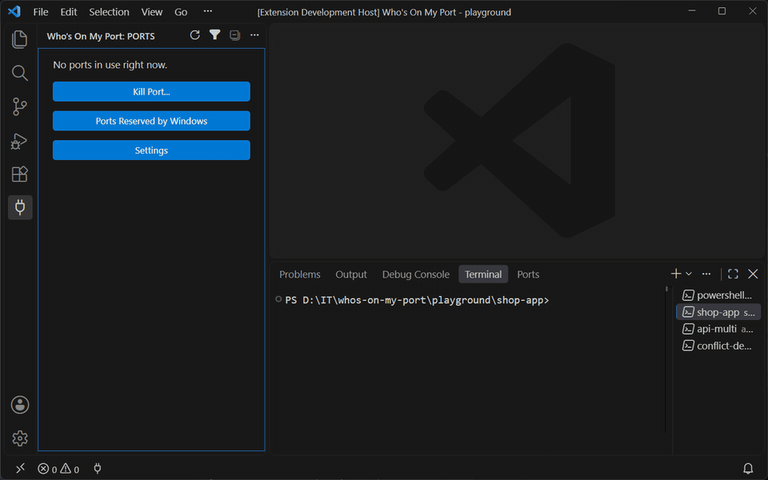

# Who's On My Port

**See which process holds a port, which project and VS Code window it belongs to, and free it safely.**

[](https://marketplace.visualstudio.com/items?itemName=OAB714.whos-on-my-port)
[](https://marketplace.visualstudio.com/items?itemName=OAB714.whos-on-my-port)
[](LICENSE)

Windows 10/11 · No telemetry · Nothing runs while the view is hidden



## Why you'll keep it installed

### 🔍 Know who's on your port
Every listening port, grouped by project. Ports started in **this** window's terminals appear first. Ports from your **other** VS Code windows carry that window's name. The extension follows the process tree back to the terminal that started each server, so it doesn't have to guess from file paths.

### 🛟 Free it without breaking anything
Servers running in your terminals get **Ctrl+C first**. They are only force-stopped (whole process tree) if they don't exit, with **Kill as Administrator** as a last resort. Windows system processes, VS Code itself, Docker and WSL forwarders are **protected** and can't be killed by accident.

### ⚡ Fix "port already in use" in one click
When a terminal prints `EADDRINUSE`, click **Kill & Retry**. The process holding the port stops and your command runs again. If the port is actually **reserved by Windows** (Hyper-V/WSL ranges, the mysterious `EACCES`), the extension tells you so and shows how to fix it.

## More

- **Restart** a dev server with the exact command that started it.
- **Port History**: servers you started or stopped, across all your projects, with one-click *Run again*. Secrets like `API_KEY=…` are hidden before saving.
- **Orphaned servers** left running after you closed a terminal are flagged and can be cleaned up in one go.
- **Test on your phone**: copy the LAN URL or show a **QR code** for servers bound to `0.0.0.0`.
- **Multi-select** (`Ctrl`/`Shift`+click), `Delete` to stop and `Enter` to open in the browser.
- ▲ / ⏱ badges for memory-hungry or long-running servers.
- Technology icons (Node, Vite, Next, Nest, Python, Django, Laravel, Go, Java, .NET…), uptime, memory, LAN marker.
- **Kill Port…** from the Command Palette, pinned ports, Sort By / Group by Project, optional Auto Refresh, Copy Port List as Markdown.
- English and Vietnamese.

## Quick start

1. Click the **plug** icon in the Activity Bar.
2. Hover a port: **open** ↗, **copy URL** ⧉, **restart** ⟳, **stop** 🗑.
3. Want the list to update by itself? Open the `…` menu and turn on **Auto Refresh**.

Assign a shortcut to free a port you use often:

```json
{ "key": "ctrl+alt+k", "command": "whosOnMyPort.killPort", "args": 3000 }
```

## Requirements

- **Windows 10 or 11.** macOS and Linux are on the roadmap.
- VS Code 1.93+. Cursor, Windsurf and VSCodium are also supported once the extension is on Open VSX.
- *Kill & Retry* and *Restart* need terminal **shell integration**: PowerShell, pwsh or Git Bash (not `cmd.exe`).

## Settings

| Setting | Default | |
|---|---|---|
| `whosOnMyPort.liveRefresh` | `false` | Update the list automatically while it is visible |
| `whosOnMyPort.liveRefreshIntervalSeconds` | `2` | Auto Refresh interval (1–60 s) |
| `whosOnMyPort.confirmBeforeKill` | `true` | Ask before stopping a process |
| `whosOnMyPort.gracefulStop` | `true` | Ctrl+C first for servers in this window's terminals |
| `whosOnMyPort.gracefulTimeoutMs` | `3000` | How long to wait before force-stopping |
| `whosOnMyPort.detectPortInUse` | `true` | Offer Kill & Retry when a terminal reports a busy port |
| `whosOnMyPort.filterDevOnly` | `true` | Hide Windows services and editor helpers |
| `whosOnMyPort.customDevProcesses` | `[]` | Extra process names to treat as dev servers |
| `whosOnMyPort.sortBy` | `port` | `port`, `memory`, `uptime` or `name` |
| `whosOnMyPort.groupByProject` | `true` | `false` shows one flat list |
| `whosOnMyPort.pinnedPorts` | `[]` | Ports always shown at the top, free or busy |
| `whosOnMyPort.history.enabled` | `true` | Record servers for Port History |
| `whosOnMyPort.memoryWarningMB` | `1024` | ▲ badge threshold (`0` = off) |
| `whosOnMyPort.longRunningHours` | `8` | ⏱ badge threshold (`0` = off) |
| `whosOnMyPort.showStatusBar` | `true` | Port counter in the status bar |

## Privacy

Nothing leaves your machine: no telemetry, no network calls. One scan runs `netstat` and a single PowerShell process query. Port History lives in VS Code's own storage, never in your project folder or your git repository.

## Troubleshooting

- **"Scan failed — PowerShell may be blocked by policy"**: some corporate machines restrict PowerShell. Run *Who's On My Port: Show Logs* and [open an issue](https://github.com/OAB710/whos-on-my-port/issues) with the output.
- **The phone can't open the LAN URL**: Windows Firewall blocks incoming connections on *Public* networks. Set your Wi-Fi to *Private* and allow Node.js when Windows asks.
- **No Kill & Retry / Restart button**: the terminal needs shell integration (PowerShell, pwsh, Git Bash). Servers started before the extension loaded can't be restarted, but stopping them still records them in Port History.

## License

[MIT](LICENSE) © OAB710. Icons in `media/runtime` come from [Material Icon Theme](https://github.com/material-extensions/vscode-material-icon-theme) (MIT).
